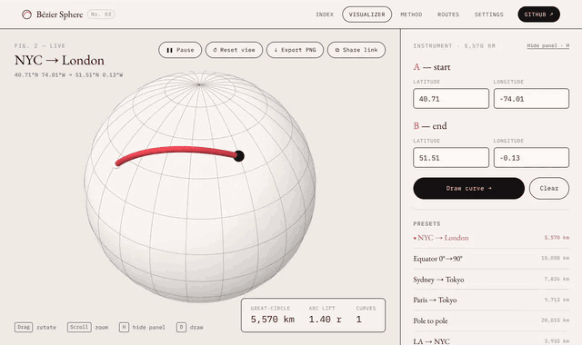

# Bézier Sphere

**Two points on a globe, one curve between.** An interactive Three.js study that turns latitude and longitude into 3D space and joins two points with a quadratic Bézier arc, drawn, rotated and zoomed in real time.



**Live:** https://bezier.kwame.co/

## Features

- **Draw arcs** between any two latitude/longitude points; the curve draws itself on, led by a small pen
- **Great-circle readout**: distance in km, arc lift and curve count for the active route
- **Shareable links**: every route updates the URL (`visualizer.html?a=40.71,-74.01&b=51.51,-0.13`); **Share link** copies it
- **Export PNG**: saves the current view as a captioned "figure" with coordinates and distance
- **Presets and saved routes**, plus a **Routes** catalogue page with dotted-globe thumbnails
- **Settings**: sphere opacity, curve thickness and colour, rotation speed, Paper / Blueprint / Night themes, graticule toggle; all with a live preview
- Orbit controls (drag to rotate, scroll to zoom), keyboard shortcuts (**H** hide panel, **D** draw), responsive down to phone width

## Pages

| File | Purpose |
|------|---------|
| `index.html` | Home: project overview, plates and route previews |
| `visualizer.html` | The interactive 3D globe |
| `method.html` | How it works: projection, the lifted control point, the stack |
| `routes.html` | Catalogue of preset and saved routes |
| `settings.html` | Visual settings (saved in `localStorage`) |
| `404.html` | Not-found page (served automatically by GitHub Pages) |
| `about.html` | Redirect to `method.html` for old links |

Scripts: `shared.js` (curve maths, presets, storage, share links, SVG globe plates), `app.js` (the Three.js visualizer, MVC), `routes-page.js`, `settings-page.js`. Styles live in `styles.css`.

## How it works

Each point is projected onto a sphere of radius 20 (`x = r·cosφ·cosλ, y = r·sinφ, z = −r·cosφ·sinλ`). The control point sits along the chord's midpoint direction at `k = 1/cos(θ/2) + 0.7·sin(θ/2)` radii, so the arc leaves the surface and rises more for longer routes. Antipodal points (e.g. pole to pole) bow towards a pole. The full write-up is on the [Method page](https://bezier.kwame.co/method.html).

## Run locally

No build step. Serve the folder with any static server, e.g.

```sh
npx serve .
# or
python3 -m http.server
```

Then open the printed URL. All links are relative, so the site also works from a subfolder.

## Deploy

**GitHub Pages:** `.github/workflows/pages.yml` publishes the site on every push to `main`. In the repository go to **Settings → Pages** and set **Source** to **GitHub Actions** (one-time).

**Custom domain (`bezier.kwame.co`):** a DNS `CNAME` record points `bezier` at `kwameessien.github.io`, and the domain is set under **Settings → Pages → Custom domain** with **Enforce HTTPS** on. Deploys from Actions ignore `CNAME` files, so the setting lives in the repository, not in a file. If the domain changes, update the `og:image` URLs in the page `<head>`s too.

**Vercel** also works: import the repo with no framework and no build command. `vercel.json` enables clean URLs (`/method`, `/settings`, …).

The social preview card (`assets/og-image.png`) is a screenshot of `tools/og-image.html` at 1200×630.

## Dependencies (via CDN)

- Three.js r128 and its OrbitControls
- jQuery 3.6.0
- EB Garamond and IBM Plex Mono (Google Fonts)
